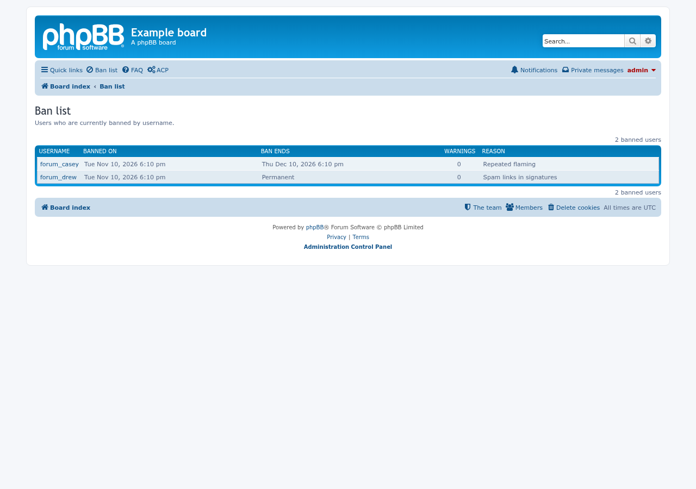
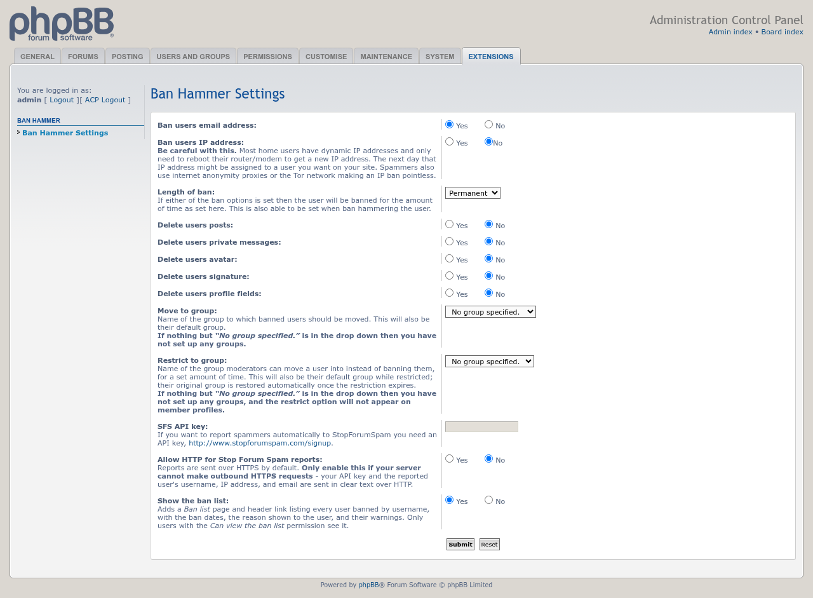

# Ban Hammer: update of 11/10/2026

Screenshots for the 11/10/2026 update of the 1.2.0-dev build.

## Ban list page

The new ban list, opened from the header link: members banned by username, when the ban started and ends, their warnings, and the reason shown to them. The staff-only reason is never shown.

## Show the ban list setting

The ban list is off until an administrator turns on Show the ban list at the bottom of the Ban Hammer settings. Only users with the Can view the ban list permission see it.

